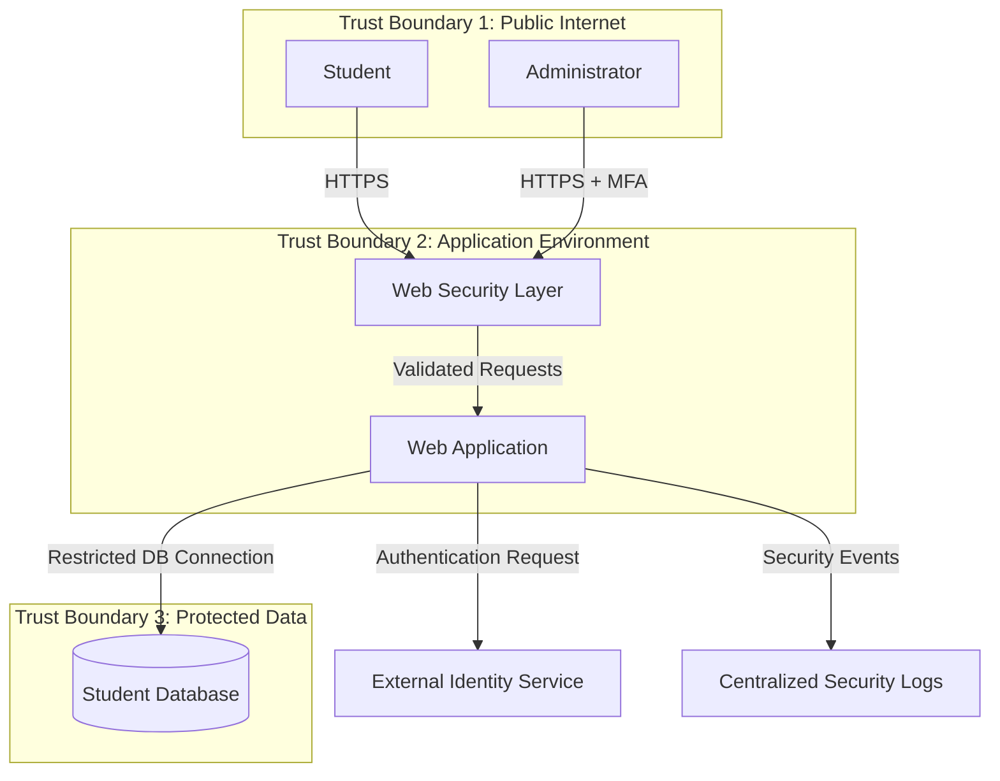

# Cyber Security Task 1: Threat Model and Secure Configuration

**Track:** Cyber Security  
**Level:** Beginner  
**Project:** Student Portal Web Application  
**Purpose:** Threat modelling and defensive security hardening

## 1. Introduction

A Student Portal is a web application that allows students to log in, view their profiles, check marks, and access academic information.

The application stores important information such as student names, login credentials, and marks. Therefore, it must protect data from unauthorized access, modification, and loss.

The objective of this project is to identify possible security threats, assess their risks, and recommend security measures to protect the application.

## 2. System Components and Assets

### Users
- Student: Logs in and views personal academic information.
- Administrator: Manages student accounts and academic records.
- Web Server: Processes requests and provides application services.
- Database: Stores user accounts, profiles, and marks.
- External Identity Service: Optionally provides secure authentication.

### Important Assets
1. Student personal information.
2. Usernames and password hashes.
3. Academic records and marks.
4. Administrator privileges.
5. Application configuration and security logs.
6. Availability of the student portal.

### Trust Boundaries
- Internet to web application: Untrusted external requests enter the application.
- Web application to database: The application accesses stored information using restricted database permissions.
- Application to external identity service: Authentication requests cross an external service boundary.

## 3. Architecture Diagram

The following diagram represents the proposed application architecture.

**Diagram explanation:** Students and administrators access the portal through HTTPS. The web security layer filters incoming requests. The application validates requests and accesses the database through a restricted connection. An external identity service may assist with authentication, while security events are recorded in centralized logs.

The trust boundaries identify where data moves between systems with different levels of trust.

## 4. STRIDE Threat Modelling

STRIDE is a method used to identify six categories of security threats.

| STRIDE category | Possible threat | Security protection |
|---|---|---|
| Spoofing | An attacker uses stolen student credentials. | Strong password hashing, rate limiting, and multi-factor authentication for administrators. |
| Tampering | An attacker changes marks without permission. | Server-side authorization, input validation, and database permissions. |
| Repudiation | A user denies changing an academic record. | Timestamped audit logs recording important actions and user identities. |
| Information Disclosure | A student accesses another student's marks. | Object-level access checks, HTTPS, and restricted database access. |
| Denial of Service | Excessive requests make the portal unavailable. | Rate limiting, request-size limits, monitoring, and suitable infrastructure protections. |
| Elevation of Privilege | A student gains administrator privileges. | Role-based access control, least privilege, and server-side permission checks. |

These are potential threats for the proposed system, not vulnerabilities discovered through live testing.

## 5. Risk Assessment and Prioritization

Risk is assessed using two factors:

- Likelihood: 1 = Rare, 2 = Unlikely, 3 = Possible, 4 = Likely, 5 = Very likely.
- Impact: 1 = Negligible, 2 = Minor, 3 = Moderate, 4 = Major, 5 = Critical.

**Risk score = Likelihood × Impact**

For this assessment:
- 1–4: Low risk
- 5–9: Medium risk
- 10–15: High risk
- 16–25: Critical risk

| ID | Risk scenario | Likelihood | Impact | Score | Priority |
|---|---|---:|---:|---:|---|
| R1 | Unauthorized access to another student's records | 4 | 5 | 20 | Critical |
| R2 | Compromised administrator account | 3 | 5 | 15 | High |
| R3 | Unauthorized modification of marks | 3 | 5 | 15 | High |
| R4 | Exposure of data during transmission | 3 | 4 | 12 | High |
| R5 | Excessive requests disrupt portal availability | 3 | 4 | 12 | High |
| R6 | Missing audit records prevent investigation | 3 | 3 | 9 | Medium |

These scores are illustrative estimates for a beginner threat model. They should be revised using actual system information and evidence.

## 6. Prioritized Security Hardening Plan

### Priority 1: Protect student records
- Verify authorization on the server for every request to access a student's records.
- Ensure students can access only their own information.
- Restrict database permissions to the minimum required.
- Use parameterized database queries to reduce SQL injection risk.

### Priority 2: Secure authentication and administrator access
- Store passwords using a suitable password-hashing algorithm such as Argon2id or bcrypt.
- Require multi-factor authentication for administrators.
- Apply rate limiting to login attempts.
- Use secure session cookies with HttpOnly, Secure, and appropriate SameSite settings.
- Expire sessions and invalidate them after logout.

### Priority 3: Protect data and communications
- Enforce HTTPS and redirect HTTP requests to HTTPS.
- Keep application secrets outside source code.
- Encrypt sensitive stored data where appropriate and protect encryption keys.
- Validate input on the server and encode output appropriately.
- Configure suitable security headers, including Content-Security-Policy.

### Priority 4: Improve availability and monitoring
- Apply request-size limits and rate limiting.
- Monitor repeated failed logins and unusual access patterns.
- Record important security events without logging passwords, session tokens, or unnecessary sensitive data.
- Back up the database regularly and test restoration.
- Apply security updates to the application, libraries, and server.

## 7. Hardening Checklist and Verification Steps

The following checklist can be used during a defensive security review.

- [ ] **HTTPS:** Confirm the site uses HTTPS and its TLS certificate is valid.
- [ ] **Authorization:** Using two test student accounts, verify that one cannot access the other's records.
- [ ] **Administrator access:** Confirm that administrative actions require the correct role and that administrator MFA is enabled.
- [ ] **Password storage:** Review the authentication configuration to confirm passwords are securely hashed, not stored as plain text.
- [ ] **Input handling:** Review database queries for parameterization and test input validation in an authorized test environment.
- [ ] **Session security:** Inspect cookie settings and confirm logout invalidates the session.
- [ ] **Security headers:** Inspect HTTP response headers and verify the intended security policies.
- [ ] **Logging:** Generate a test login failure and verify that the event is recorded without exposing credentials.
- [ ] **Backups:** Confirm backups exist and document the result of a test restoration.
- [ ] **Updates:** Review dependency and server versions for available security updates.

**Verification status:** These checks are proposed verification steps. They must be performed on an actual test environment before being marked as passed. No live application has been tested as part of this report.

## 8. Implementation Order

1. Fix authorization weaknesses that could expose student records.
2. Secure administrator accounts and authentication.
3. Enforce HTTPS and improve session security.
4. Review database access and input handling.
5. Configure logging, monitoring, backups, and updates.
6. Repeat the verification checklist after implementing changes.

This order prioritizes protection of sensitive academic records and privileged accounts before additional hardening tasks.

## 9. Conclusion

This project demonstrates how threat modelling can identify security risks in a student portal before they are exploited. The STRIDE method was used to identify potential threats, and likelihood and impact scores were used to prioritize them.

The proposed hardening plan focuses on authorization, authentication, secure communications, database protection, logging, and availability. The verification checklist provides practical steps for reviewing these controls.

Threat modelling is an ongoing process. The model should be updated whenever the application's architecture, features, or security requirements change.

**Project type:** Defensive cybersecurity assessment  
**Scope:** Hypothetical student portal  
**Testing status:** Proposed controls and verification steps; no live testing performed.
